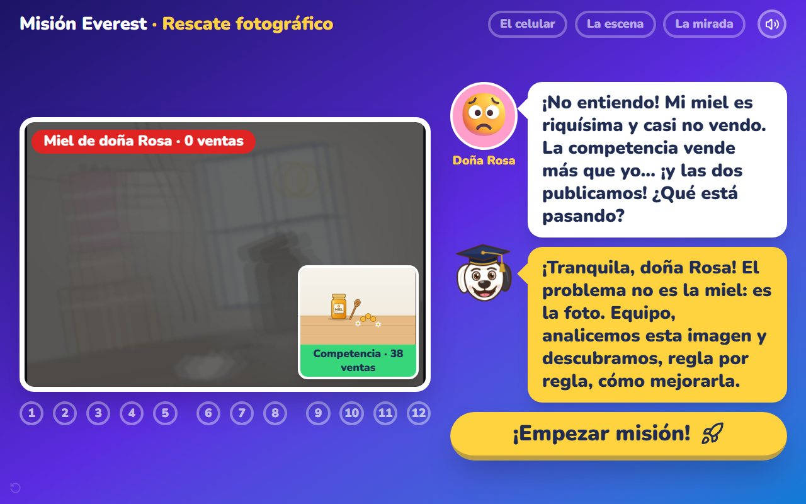
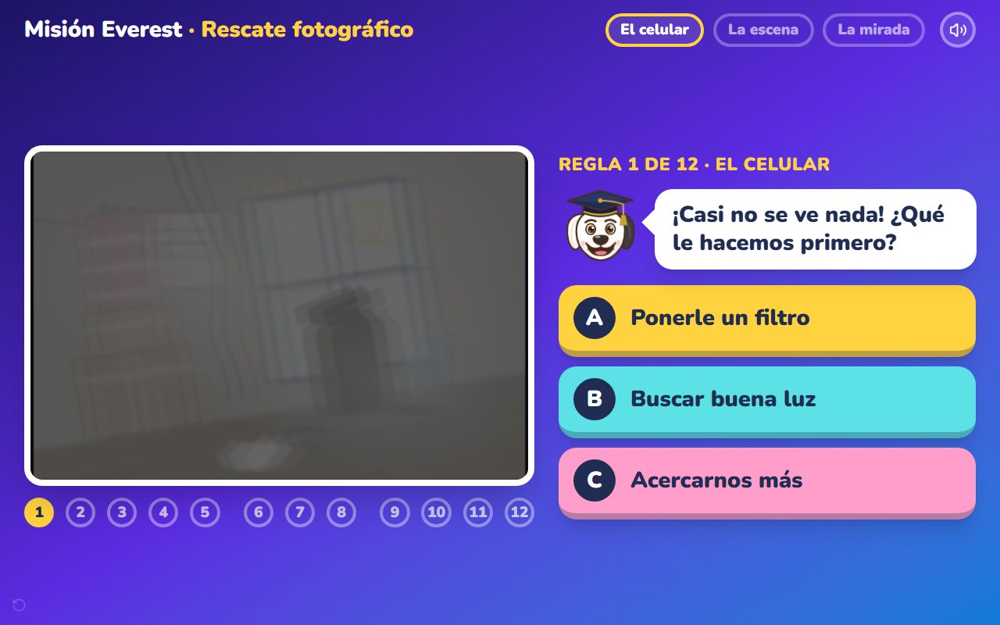
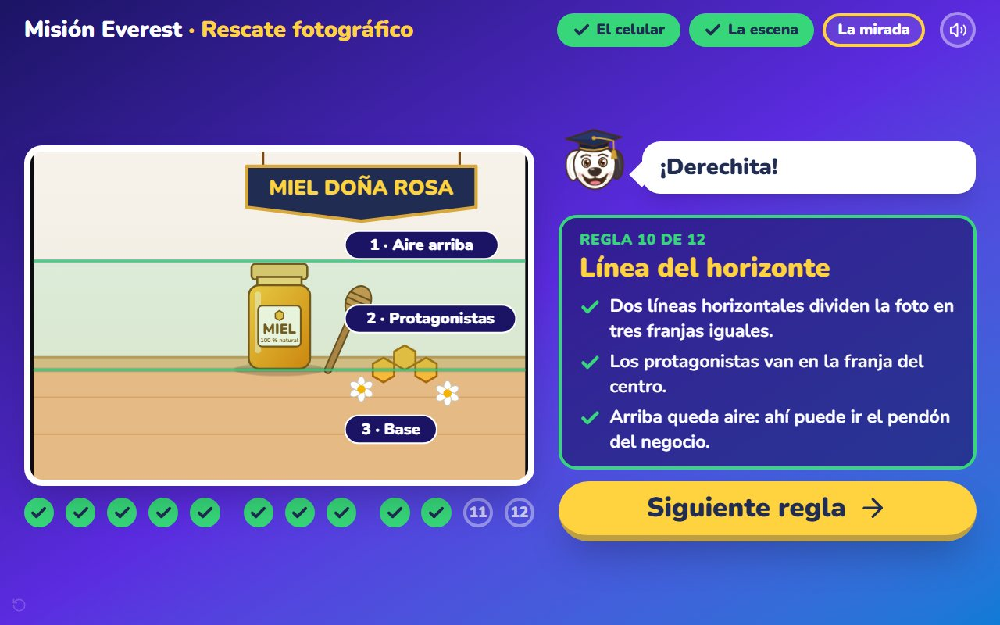
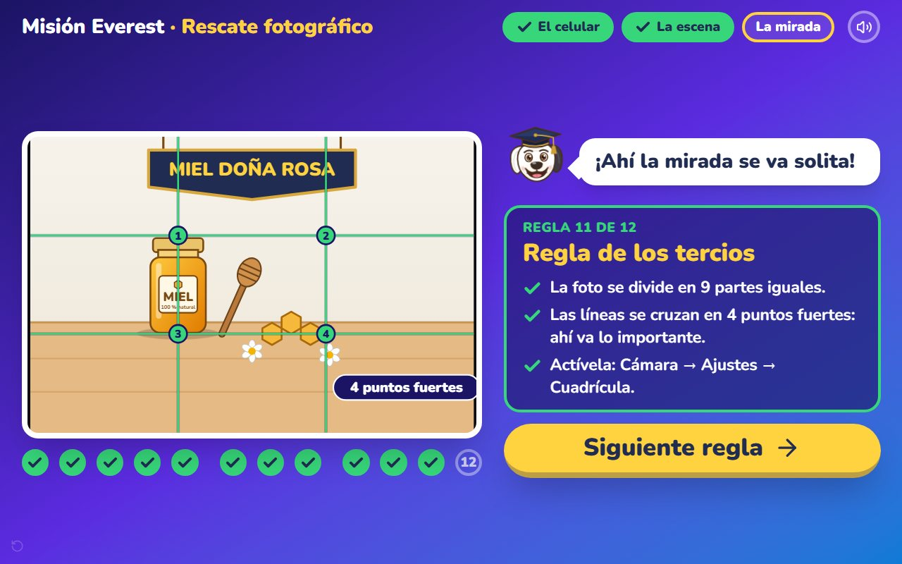
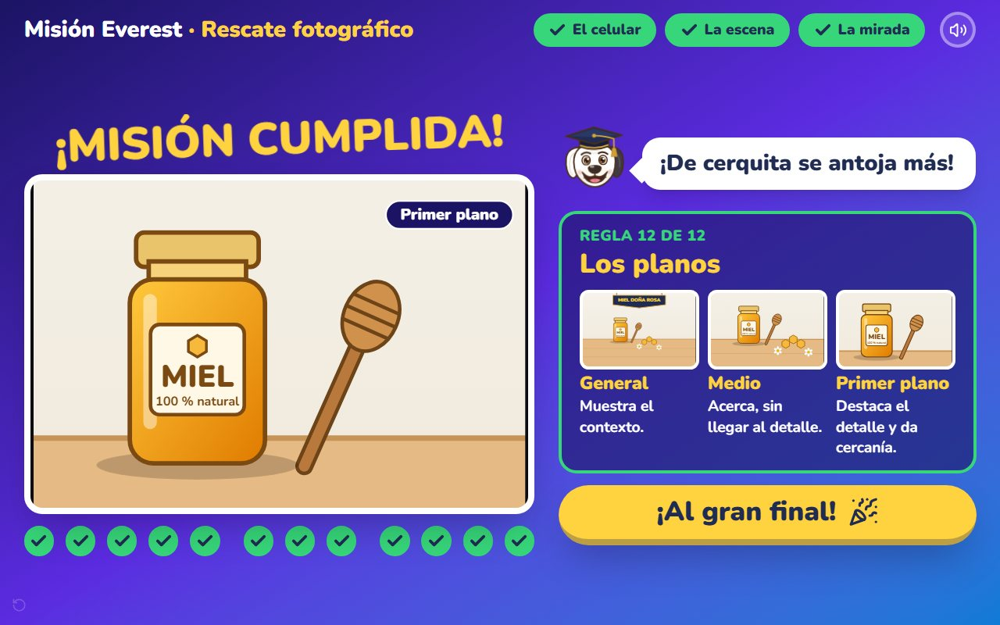
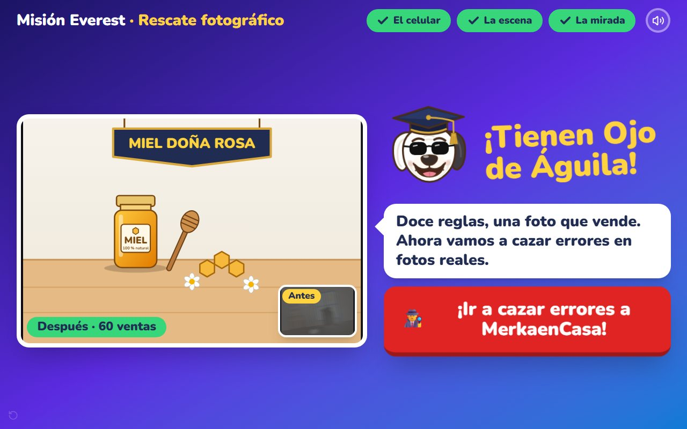
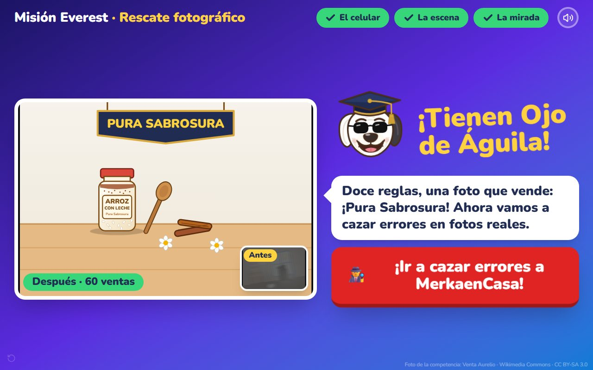

<picture>
  <source media="(prefers-color-scheme: dark)" srcset="assets/mys-logo-blanco.png">
  
</picture>

# 🐕 Misión Everest · Rescate fotográfico

### Un juego de aula donde el grupo rescata una foto desastrosa en doce reglas, hasta convertirla en una foto que vende

**MyS SinergiaaS**: Consultoría y Tecnología
*Automatiza. Escala. Vende.*

`En producción` · `Sin registro` · `Sin instalación` · `Letra gigante` · `Hecho para proyectar` · `Dos ediciones`

---

## El problema

Una emprendedora publica su producto igual que la competencia y no vende. No
sabe por qué. La respuesta casi siempre está en la foto, pero una lista de
«reglas de fotografía» no le dice nada a quien nunca ha visto esas reglas
actuar sobre su propia imagen.

## La solución

**Una sola foto, doce errores y un grupo que la rescata.** Doña Rosa llega con
la pregunta de todo emprendedor: *«¿Por qué no vendo, si las dos publicamos?»*.
Everest, el tutor de MyS SinergiaaS, responde que el problema no es la miel: es
la foto. Y le pide al grupo que la arregle, regla por regla.

### Cada reto es una pregunta para todo el salón
Tres opciones gigantes, de colores. Si el grupo falla, Everest da una pista
con humor y nadie queda en evidencia. Si acierta, hay celebración y la foto
mejora delante de todos.

### La regla queda dibujada sobre la foto
Al acertar no solo hay confeti: la regla aparece trazada encima de la imagen y
explicada punto por punto. La luz, el contraluz, la nitidez, el enfoque, el
fondo, el orden, el espacio, la posición del celular, la línea del horizonte,
la regla de los tercios y los planos.

### Un final con antes y después
La foto que tenía cero ventas termina con su pendón, bien compuesta y con las
ventas que merece. Y el grupo sale a cazar errores en fotos reales.

### Dos ediciones, la misma misión
La misma dinámica se vuelve a contar con otra emprendedora y otro producto:
doña Pura y su arroz con leche «Pura Sabrosura».
**→ [mision-dona-pura.vercel.app](https://mision-dona-pura.vercel.app)**

---

## Lo que lo hace distinto

| | |
|---|---|
| 🎯 **Una historia, no un cuestionario** | Hay una clienta, un problema y un resultado: la foto pasa de 0 a 60 ventas. |
| 🖼️ **La foto cambia de verdad** | Cada acierto corrige un error visible; el grupo ve el efecto de la regla. |
| 📐 **Enseña mientras celebra** | Cada regla queda dibujada sobre la foto y explicada en tres puntos. |
| 🧓 **Pensado para adultos mayores** | Letra gigante, colores vivos, una pregunta por pantalla y sin castigo al fallar. |
| 🖥️ **Hecho para el proyector** | Se juega con el teclado o tocando, con sonidos y celebraciones. |
| 🏷️ **Adaptable** | Otra emprendedora, otro producto, otra marca: la segunda edición lo demuestra. |

---

## Para quién

- **Docentes y programas de emprendimiento** que enseñan ventas por internet.
- **Cámaras de comercio, fundaciones, cajas de compensación y alcaldías** con
  programas de inclusión digital.
- **Marcas y comercios** que quieren capacitar a sus vendedores en fotografía
  de producto.

---

## Probarlo

No se instala nada. No hay registro. Se abre el enlace y se juega:

### **→ [mision-everest.vercel.app](https://mision-everest.vercel.app)**

---

## Modalidades de implementación

| Modalidad | Para quién |
|---|---|
| **Uso directo** | La herramienta pública, tal como está, abierta para cualquier aula. |
| **Marca blanca** | Su identidad visual, su dominio y sus propios productos de ejemplo. |
| **Implementación a la medida** | Otros temas de clase enseñados con la misma dinámica. |
| **Taller facilitado** | La experiencia completa, dirigida en su institución por MyS SinergiaaS. |

Para cotizar cualquiera de ellas: **[hablemos por WhatsApp](https://wa.me/573148788974)**.

---

## ⚖️ Aviso legal y comercial

> **Este repositorio es una exhibición de portafolio.**
>
> Publica el **resultado** del producto (qué resuelve, cómo se usa y qué
> entrega) con fines comerciales y de demostración de capacidad técnica.
> **No contiene el código fuente de la aplicación.**
>
> El código fuente, el contenido pedagógico y el diseño de la dinámica son
> **propiedad intelectual exclusiva de MyS SinergiaaS**. No se distribuyen,
> licencian ni publican bajo ninguna licencia de código abierto.
>
> La foto de la competencia que aparece en la edición de doña Pura es
> «Arroz con leche casero», de Venta Aurelio (Wikimedia Commons, CC BY-SA 3.0).
>
> El acceso público se ofrece para evaluación, demostración y uso en el aula.
> Su uso comercial, reventa, ingeniería inversa o incorporación a un producto
> de terceros requiere acuerdo escrito previo.
>
> © 2026 MyS SinergiaaS. Todos los derechos reservados.

---

## Hablemos

**Mac Eduardo Sáenz Martínez**
Dirección de Proyectos · Arquitectura de Soluciones · Transformación Digital
Valencia, Córdoba (Colombia)

